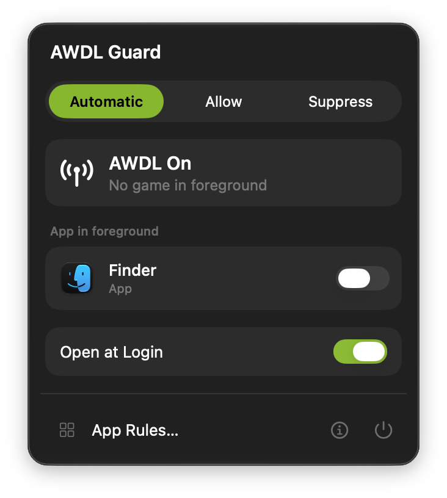

# AWDL Guard

Turns off AWDL while you play, and back on when you stop.

  

AWDL is the wireless link behind AirDrop. It shares the Wi-Fi radio and hops channels in
the background, which can show up as lag spikes in online games and game streaming.

AWDL Guard lives in the menu bar. When a game is in the foreground on Wi-Fi, it turns AWDL
off. When you switch away, it turns it back on. The menu always shows what it did, and
"AWDL Off" appears only once AWDL is confirmed off.

While AWDL is off, AirDrop, Sidecar, Universal Control and peer-to-peer AirPlay don't
work. They come back as soon as AWDL does.

## Install

1. Download the latest zip from [Releases](https://github.com/reefsoft-io/AWDLGuard/releases/latest),
   open it and move **AWDL Guard** to Applications.
2. Open AWDL Guard, open its menu and choose **Install…**.
3. In System Settings, turn on AWDL Guard under **Allow in the Background**.

AWDL Guard needs macOS 26 or later. It installs a small helper, because only the
system can turn AWDL off.

## Use

Pick a mode in the menu:

- **Automatic** turns AWDL off while a game, or an app you've added, is in the foreground
  on Wi-Fi.
- **Allow** leaves AWDL on.
- **Suppress** keeps AWDL off.

Games are recognised automatically. To include another app, or leave a game out, flip the
switch under **App in foreground** while it's open, or add it in **App Rules…**.

Windows games running in CrossOver work too. Flip the switch while the game is open, or
choose its `.exe` in App Rules.

Holding Option in the menu turns Quit into **Hide Menu Bar Item**. AWDL Guard keeps
working, and opening it again from Finder brings the item back.

## Uninstall

Quit AWDL Guard, then delete it from Applications. The helper lives inside the app and
goes with it. AWDL is back on as soon as the app quits.

## Privacy

AWDL Guard doesn't connect to the internet and collects nothing. It only checks which app
is in the foreground and whether you're on Wi-Fi.

## Credits

Based on [AWDL Control](https://github.com/james-howard/AWDLControl) by James Howard,
after an idea from [awdlkiller](https://github.com/jamestut/awdlkiller) by James Nugraha.

Building from source and how it works: [docs/DEVELOPMENT.md](docs/DEVELOPMENT.md).

## Licence

MIT. See [LICENSE.txt](LICENSE.txt).
